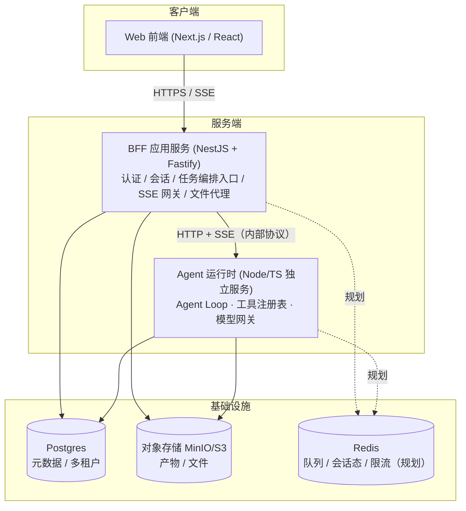
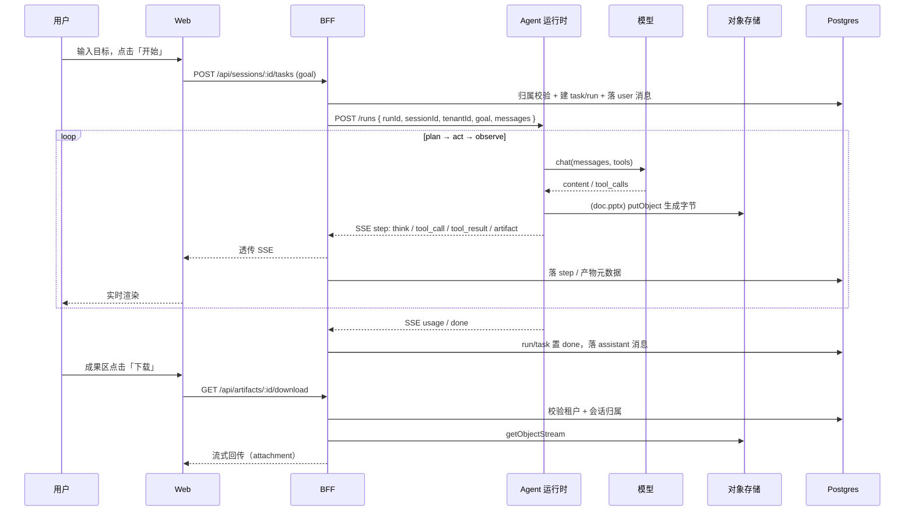
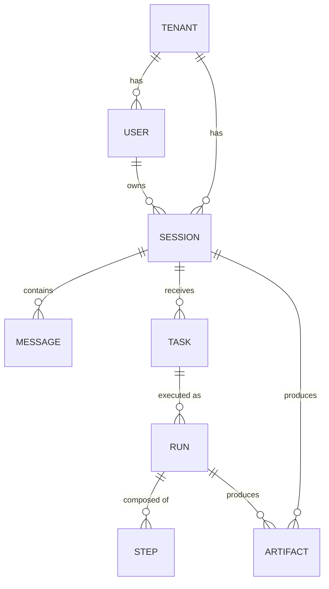

# AI 办公智能体 · 概要设计（Overview Design）

- 版本：v1.0
- 日期：2026-10-16
- 状态：随 M2 交付更新
- 对标产品：腾讯 WorkBuddy（AI 原生「数字同事」）
- 关联文档：
  - 上游总体设计：`docs/superpowers/specs/2026-10-15-ai-office-agent-design.md`
  - 架构设计：`docs/design/02-architecture.md`
  - 详细设计：`docs/design/03-detailed-design.md`
  - 代码开发文档：`docs/develop/04-dev-guide.md`
  - 开发计划：`docs/develop/05-dev-plan.md`
  - 部署文档：`docs/deploy/06-deployment.md`
  - 数据库脚本：`docs/db/schema.sql`

---

## 1. 项目背景与定位

### 1.1 背景

WorkBuddy 是腾讯推出的 AI 原生桌面智能体，核心理念是让 AI 从「会聊天」进化为「会干活」：用户下达目标，Agent 自行拆解步骤、调用工具执行，直接交付 Word / Excel / PPT 等成果。其被验证过的架构为 **「产品外壳 / app-server / agent-runtime」三层解耦**，层间通过稳定协议通信。

本项目复刻其能力，目标是交付一个**生产级商业产品**（非 Demo / MVP），最终形态包含服务端、桌面端、网页端。

### 1.2 现实约束与策略

- 团队：1–2 人、业余节奏。
- 策略：**逐步演进的商业产品**——每个里程碑都交付一个可运行、可验证的版本，功能由窄到宽，「顺序」优先于「覆盖面」。
- 三端排序：先网页端（v1），桌面端复用同一 Agent 运行时（阶段二），企业层（阶段三）。

### 1.3 目标与非目标

**目标**

- v1：交付网页端可用的 AI 办公智能体（服务端 + 网页端）。
- 架构预留：多租户、桌面端复用同一 Agent 运行时、私有化/信创。

**非目标（v1 明确不做）**

- 桌面端本地文件操作、在线人机双写协作编辑器。
- 企业微信集成、企业后台、SSO、审计中心、定时/远程派活。

### 1.4 已确认的关键决策

| 议题 | 决策 |
|---|---|
| 项目定位 | 完整商业产品（逐步演进，非 Demo） |
| 团队 | 1–2 人 / 业余 |
| v1 链路 | 服务端 + 网页端 |
| 目标用户 | 先个人后企业，架构预留多租户 |
| 技术栈 | TypeScript 全栈（对齐 WorkBuddy 体系） |
| v1 架构 | 方案 B —— 三层解耦（对标 WorkBuddy） |

---

## 2. 系统概述

### 2.1 一句话概述

用户在一个网页工作台里**下达一个目标**（如「调研某竞品并生成一份 PPT」），Agent 运行时实时**规划 / 调用工具 / 观察结果**，全过程通过 SSE 流式回显；最终产出 docx / xlsx / pptx 文档落对象存储，用户在**成果区**查看并下载。

### 2.2 已交付能力（截至 M2）

| 里程碑 | 能力 |
|---|---|
| **M0 脚手架** | 三层骨架 + SSE 打通（前端可收到运行时流式事件） |
| **M1 最小闭环** | 账号（邮箱密码注册登录 + JWT）、多会话与消息持久化、真模型驱动的 Agent Loop、联网工具 `web.search` / `web.fetch` |
| **M2 会干活** | 工具系统扩展（`doc.docx` / `doc.xlsx` / `doc.pptx`）、产物落对象存储（MinIO/S3）与元数据落库、网页成果区（列表 + 下载）、下载鉴权（租户 + 用户级隔离） |

### 2.3 规划能力（M3–M5，见开发计划）

| 里程碑 | 目标 |
|---|---|
| **M3 安全** | 沙箱执行、工具权限分级（safe/confirm/blocked）、破坏性操作确认卡片 |
| **M4 扩展** | 知识库 RAG（pgvector）、连接器 / MCP Host |
| **M5 商业化** | 计费与用量、可观测、上线个人版 |
| 阶段二 | 桌面端（Electron + Monaco，复用 Agent 运行时）→ 人机双写 |
| 阶段三 | 企业层（组织/权限/审计/SSO/私有化/信创）→ 企微集成 |

---

## 3. 总体架构

### 3.1 分层视图

系统按 **4 个可独立部署单元 + 1 层基础设施** 组织：

### 3.2 各层职责

| 层 | 职责 | 不做什么 |
|---|---|---|
| **Web** | 目标输入、SSE 实时渲染（思考/工具调用/产物）、成果区与下载、登录注册 | 不直连数据库与对象存储；不跑 Agent |
| **BFF** | 认证鉴权、多租户与行级隔离、会话与消息管理、任务编排入口、SSE 转发与落库、产物元数据、下载代理（租户校验） | 不跑 Agent Loop；不经手大文件字节（文档字节由 runtime 直传对象存储） |
| **Agent 运行时** | Agent Loop（plan→act→observe）、工具注册表、模型网关、文档生成、对象存储写入、（规划）沙箱 / MCP Host | 不处理账号/计费/多租户业务 |
| **基础设施** | Postgres（结构化元数据）、对象存储（产物）、（规划）Redis（队列/限流） | — |

### 3.3 关键架构判断

- **BFF 与 Agent 运行时分离**：Agent 长任务需可重启/可恢复/可隔离，进程边界比组件边界更可靠；也让未来桌面端复用同一套 Agent 运行时。
- **字节只落地一次**：文档字节由 runtime 直接写入对象存储，BFF 只保存元数据并代理下载流，避免大文件穿 BFF 造成内存与带宽浪费。
- **模型网关单列（规划收口）**：多模型、私有化换模型、按 token 计费、限流收口到一处；当前以 `ModelGateway` 接口预留。

---

## 4. 核心业务流程

### 4.1 一次「下达目标 → 产出成果」主流程

### 4.2 关键子流程索引

| 流程 | 说明 | 详见 |
|---|---|---|
| 注册 / 登录 | 邮箱密码 → argon2 哈希 → 签发 JWT（HS256, 7d） | 详细设计 §BFF-Auth |
| 会话与消息 | 会话 CRUD、消息历史按 seq 排序 | 详细设计 §BFF-Sessions |
| Agent Loop | plan→act→observe，工具调用与观测，`artifact` 事件补发 | 详细设计 §Runtime-Loop |
| 文档生成 | 三工具生成字节 → 上传 → 返回 `ArtifactRef` | 详细设计 §Runtime-Tools |
| 产物下载 | BFF 校验归属 → 代理对象流 + 响应头清洗 | 详细设计 §BFF-Artifacts |

---

## 5. 核心领域模型（概览）

统一多租户：所有业务表带 `tenantId`；个人用户 = 一个 `personal` 租户，企业 = `org` 租户（v1 只跑个人版，表结构预留）。

| 实体 | 说明 | 关键字段 |
|---|---|---|
| `Tenant` | 租户/组织 | id, type, name, plan |
| `User` | 用户 | id, tenantId, email(唯一), passwordHash, status |
| `Session` | 会话（一段上下文） | id, tenantId, userId, title, status |
| `Message` | 对话消息 | id, sessionId, role, content, seq（`@@unique(sessionId, seq)`） |
| `Task` | 用户下达的目标 | id, sessionId, goal, status |
| `Run` | 一次 Agent 执行实例 | id, taskId, status, startedAt, endedAt |
| `Step` | Agent loop 单步 | id, runId, seq, type, payload（`@@unique(runId, seq)`） |
| `Artifact` | 产出物 | id, tenantId, sessionId, runId, kind, filename, storageKey, size, version |

> `step` 表既是**实时渲染的数据源**，也是**审计与回放**的基础。

---

## 6. 技术栈

| 层 | 选型 | 说明 |
|---|---|---|
| 语言 | TypeScript 5.6（strict） | 全栈统一 |
| 运行时 | Node.js ≥ 22（ESM） | 顶层 await 可用 |
| 前端 | Next.js 15（App Router）+ React 19 | 网页端 |
| BFF | NestJS 10 + Fastify 4 | 结构化、利于多租户；Fastify 提升吞吐 |
| ORM | Prisma 6 | 类型安全、迁移友好 |
| 数据库 | Postgres 16 | 元数据 + 多租户（规划 pgvector） |
| 对象存储 | MinIO（S3 兼容） | 产物存储，本地 docker |
| Agent 运行时 | Node/TS 独立服务（原生 `http`） | plan→act→observe 引擎 |
| 模型接入 | OpenAI 兼容协议（默认 DeepSeek） | `ModelGateway` 抽象，可换模型 |
| 文档生成 | `docx` / `exceljs` / `pptxgenjs` | 对齐上游选型 |
| 鉴权 | JWT（HS256）+ argon2 | 密码哈希与令牌 |
| 构建/测试 | pnpm 10 + Turborepo 2 + Vitest 2 | 单仓多包 |

> 框架为可调整的默认选型：若后续有强约束（如更熟 Hono/Python），在实施计划阶段替换，不影响分层架构。

---

## 7. 质量属性概览

| 属性 | 现状（M0–M2） | 规划（M3+） |
|---|---|---|
| **安全** | JWT 鉴权；`tenantId` 强制行级隔离并逐查询校验；下载越权 404（不泄露存在性）；`web.fetch` SSRF 防护（全部地址校验 + 连接固定已校验 IP + 不跟随跳转）；文件名清洗防 HTTP 头注入；BFF→runtime 可选共享密钥；runtime 默认仅绑本机 | 工具权限三级 + 确认卡片；沙箱执行；`code.exec` 隔离；连接器凭证加密入库 |
| **可靠性** | 上游不可达回 502 并落 failed；落库失败不挂起客户端（best-effort + 无条件终止响应）；客户端断连主动 cancel 上游流与销毁 S3 流 | 队列化 + 可恢复/断点续传；模型失败重试 + fallback |
| **可观测** | 结构化日志（Nest Logger）；`step` 全链路可回放 | 全链路 trace、token/成本指标、看板与告警 |
| **性能** | I/O 密集型，Node 事件循环适配；Fastify adapter；字节不穿 BFF | 无状态多实例 + 负载均衡；CPU 密集（沙箱/文档）隔离到独立 worker/容器 |
| **可维护** | 分层清晰、单测覆盖核心路径、TDD；提交信息规范（中文） | CI/CD、契约测试、覆盖率门槛 |

---

## 8. 里程碑路线图

| 期 | 目标 | 状态 |
|---|---|---|
| **M0 脚手架** | 三层骨架 + SSE 打通 | ✅ 已交付 |
| **M1 最小闭环** | 账号 + 会话 + 基础 Agent Loop（单模型 + 2 内置工具） | ✅ 已交付 |
| **M2 会干活** | 工具系统 + 文档生成 + 成果区 | ✅ 已交付 |
| **M3 安全** | 沙箱 + 确认卡片 + 权限分级 | 规划 |
| **M4 扩展** | 知识库 RAG + 连接器/MCP | 规划 |
| **M5 商业化** | 计费 + 用量 + 可观测 + 上线个人版 | 规划 |

**阶段二**：桌面端（Electron + Monaco，复用 Agent 运行时）→ 人机双写。
**阶段三**：企业层（组织/权限/审计/SSO/私有化/信创）→ 企微集成。

详细任务拆解与排期见 `docs/develop/05-dev-plan.md`。

---

## 9. 术语表

| 术语 | 含义 |
|---|---|
| **Session（会话）** | 一段有上下文的对话容器，归属某用户与租户 |
| **Task（任务）** | 用户下达的一次目标 |
| **Run（运行）** | Task 的一次 Agent 执行实例（可多次） |
| **Step（步）** | Agent Loop 的单步事件：`think` / `tool_call` / `tool_result` / `artifact` |
| **Artifact（产物）** | 工具产出的文档（docx/xlsx/pptx），字节在对象存储、元数据在 Postgres |
| **RunContext** | 单次运行的上下文（tenantId/sessionId/runId），注入工具执行 |
| **ModelGateway** | 模型接入抽象，屏蔽 provider 差异（OpenAI 兼容协议） |
| **SSE** | Server-Sent Events，服务端到客户端的单向流式推送 |
| **BFF** | Backend for Frontend，面向前端的应用服务层 |
