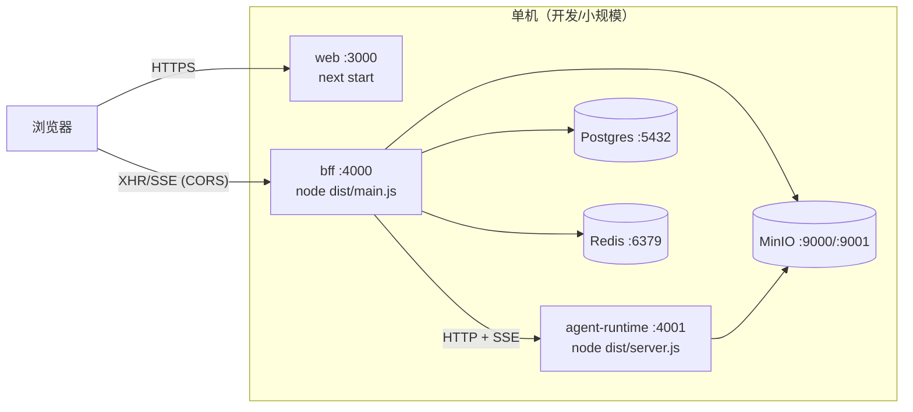
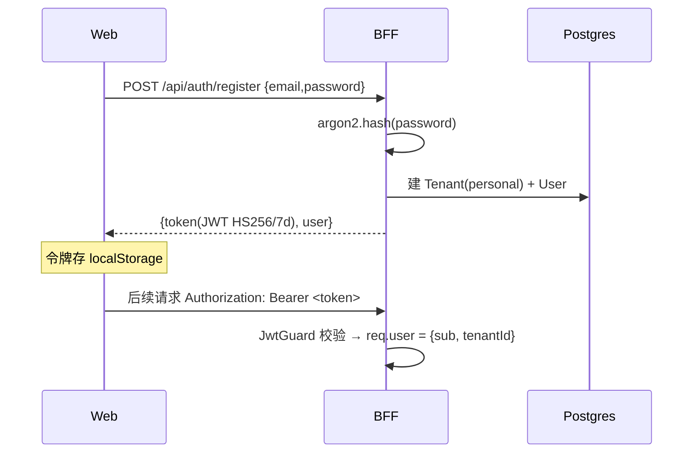
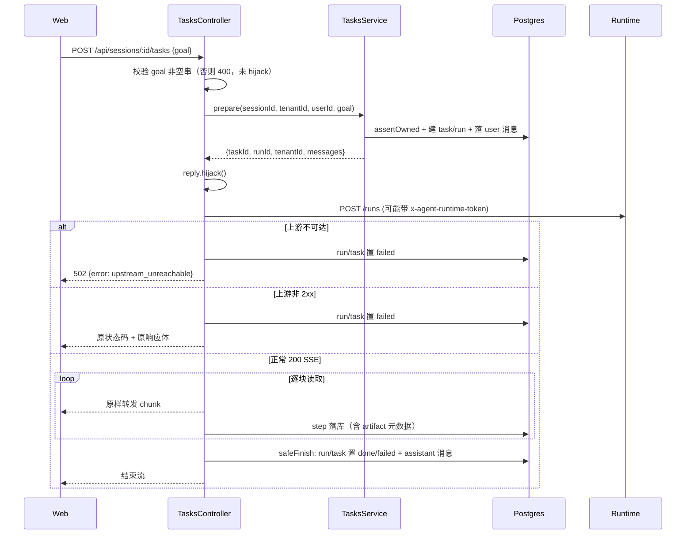
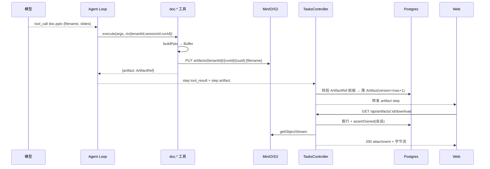

# AI 办公智能体 · 架构设计（Architecture Design）

- 版本：v1.1
- 日期：2026-10-26
- 状态：随 M5b-3 队列交付更新
- 关联：`docs/design/01-overview-design.md`、`docs/design/03-detailed-design.md`、`docs/deploy/06-deployment.md`

---

## 1. 架构目标与原则

### 1.1 目标

1. **三层解耦**：产品外壳（Web）/ 应用服务（BFF）/ Agent 运行时，层间以稳定协议通信，可独立演进与部署。
2. **生产可用**：安全边界、容错、资源回收、并发与数据一致性按生产标准设计，不做「先跑通再补」。
3. **可扩展**：预留多租户、横向扩展、桌面端复用、私有化换模型。
4. **可维护**：分层清晰、契约集中、核心路径有测试守护。

### 1.2 原则

| 原则 | 体现 |
|---|---|
| 单一职责 | 每层只做本职（BFF 不跑 Agent、runtime 不碰账号） |
| 契约先行 | 跨层类型集中在 `@ai-office/shared` |
| 无状态优先 | BFF/runtime 无会话态，便于横向扩展；任务作业与限流计数共享 Redis（M5b-3/M5a），运行权威状态仍在 Postgres |
| 字节不穿 BFF | 大对象由产生方直写对象存储，BFF 只代理下载流 |
| 边界校验 | 不信任跨进程输入（runtime 的产物引用、模型的 filename/URL） |
| 失败要可降级 | 落库失败不挂起客户端；模型/网络失败不伪造成功 |

### 1.3 约束

- 1–2 人团队，优先开发速度与正确性，避免过度工程。
- 本地开发以 docker compose 起 Postgres + MinIO，单机三进程。
- 当前部署形态为单实例；多实例/队列/沙箱为后续演进。

---

## 2. 部署单元与进程边界



| 单元 | 入口 | 端口（默认） | 进程模型 |
|---|---|---|---|
| `apps/web` | `next start -p 3000` | 3000 | Node 服务（SSR/静态） |
| `apps/bff` | `node dist/main.js` | 4000 | Node 服务（NestJS + Fastify） |
| `apps/agent-runtime` | `node dist/server.js` | 4001 | Node 服务（原生 `http`） |
| Postgres | docker | 5432 | 外部依赖 |
| MinIO | docker | 9000（API）/ 9001（控制台） | 外部依赖 |
| Redis | docker | 6379 | 外部依赖（队列/限流；未配时退化为进程内联执行） |

> **关键**：`agent-runtime` 默认仅绑 `127.0.0.1`；未配 `AGENT_RUNTIME_TOKEN` 时**只放行回环来源**（fail-closed）。对外暴露必须设 `AGENT_RUNTIME_HOST=0.0.0.0` 并配 `AGENT_RUNTIME_TOKEN`，BFF 会自动携带同一 token。

---

## 3. 分层架构详解

### 3.1 Web 层（`apps/web`）

- 技术：Next.js 15 App Router + React 19；客户端组件为主。
- 职责：目标输入与提交、SSE 增量解析与渲染、成果区列表与下载、登录注册、令牌本地保存。
- 与 BFF 的边界：仅通过 `NEXT_PUBLIC_BFF_URL` 访问 BFF REST/SSE 接口；不直连数据库与对象存储。
- 关键点：
  - JWT 走 `Authorization` 头，故下载不能用 `<a href>`，须 `fetch` 取 blob 再触发保存。
  - SSE 解析复用 `@ai-office/shared` 的有状态解析器（与 BFF 同一实现，避免协议漂移）。

### 3.2 BFF 层（`apps/bff`）

- 技术：NestJS 10 + Fastify adapter；Prisma 6 访问 Postgres。
- 职责：
  - **认证**：注册/登录、JWT 签发与校验（Guard）。
  - **多租户**：所有查询带 `tenantId`，会话归属逐查询校验（`assertOwned`）。
  - **会话与消息**：会话 CRUD、消息历史。
  - **任务编排入口**：建 task/run、落 user 消息、把完整历史透传给 runtime。
  - **SSE 网关**：转发 runtime 的 SSE，边转发边解析以落库（step / 产物元数据），处理客户端断连与上游故障。
  - **产物元数据与下载代理**：落 `Artifact` 行、列表、代理对象流下载（租户 + 用户校验、响应头清洗）。
- 边界：**不跑 Agent Loop**，不经手大文件字节。

### 3.3 Agent 运行时（`apps/agent-runtime`）

- 技术：Node/TS 独立服务，原生 `http` 建服务；工具与文档库。
- 职责：
  - **Agent Loop**：plan→act→observe，受 `maxRounds` 保护；按 `checkpoint` 续跑。
  - **工具注册表**：`web.search` / `web.fetch` / `doc.docx` / `doc.xlsx` / `doc.pptx` / `code.exec`（沙箱）/ `kb.retrieve`；MCP 工具以 `mcp.<server>.<tool>` 动态注入。
  - **权限与确认**：工具标注 `safe` / `confirm` / `blocked`，`confirm` 执行前挂起并下发确认卡片。
  - **模型网关**：OpenAI 兼容协议接入（默认 DeepSeek），多路由与 fallback，无 key 时确定性 Mock。
  - **对象存储写入**：产物字节直传 S3 兼容存储。
  - **MCP Host**：stdio 接入，进程池按 `(tenantId, name)` 隔离，心跳与崩溃退避重拉。
- 协议：接收 BFF 的 `POST /runs`（JSON），以 SSE 回流 `step` / `usage` / `status` / `checkpoint` / `done` / `error`。

---

## 4. 接口契约

### 4.1 外部 HTTP 接口（Web ↔ BFF）

| 方法 | 路径 | 鉴权 | 说明 |
|---|---|---|---|
| POST | `/api/auth/register` | 否 | 注册，返回 `{token, user}` |
| POST | `/api/auth/login` | 否 | 登录，返回 `{token, user}` |
| GET | `/api/sessions` | JWT | 本用户会话列表（倒序） |
| POST | `/api/sessions` | JWT | 新建会话 |
| GET | `/api/sessions/:id/messages` | JWT | 会话消息（按 seq 升序） |
| POST | `/api/sessions/:id/tasks` | JWT | 下达目标，返回 SSE 流 |
| GET | `/api/sessions/:id/artifacts` | JWT | 会话产物列表（倒序） |
| GET | `/api/artifacts/:id/download` | JWT | 下载产物（流式） |

### 4.2 内部接口（BFF → runtime）

| 方法 | 路径 | 说明 |
|---|---|---|
| GET | `/health` | 健康检查，返回 `{ok:true}` |
| GET | `/metrics` | Prometheus 指标（回环或 `x-internal-token`） |
| POST | `/runs` | 执行一次运行，请求体 `RunRequest`，响应 `text/event-stream` |
| POST | `/kb/ingest` | 知识库文档解析/切分/向量化入库 |
| POST | `/connectors/validate` | 校验 MCP 连接器配置 |

**`RunRequest`**（`@ai-office/shared`，节选）：

```ts
interface RunRequest {
  runId: string;       // BFF 生成，保证落库与 SSE 对齐
  sessionId: string;
  tenantId: string;    // 产物 Key 需按租户隔离，BFF 从 JWT 取出透传
  userId: string;      // 知识库按 tenant + user 隔离
  goal: string;
  messages: ChatMessage[];
  billing?: RunBilling;             // 预占额度、允许模型与价格
  config?: RunConfig;               // 管理端参数（夹取后生效）
  modelRoutes?: RunModelRoute[];    // 按优先级的路由与 fallback
  enabledTools?: string[];          // 允许的内置工具；空数组表示禁用
  permissionMode?: AssistantPermissionMode;
  kbIds?: string[];                 // 助手绑定的知识库
  resume?: RunResume;               // 断点续跑：BFF 从 RunCheckpoint 读出后下发
}
```

### 4.3 SSE 事件契约

| event | data | 说明 |
|---|---|---|
| `step` | `AgentEvent` | 单步事件，`type ∈ {think, tool_call, tool_result, artifact, confirm_request, notice}` |
| `usage` | `{input, output}` | 累计 token 用量（透传，结算用） |
| `status` | `{status}` | 排队/执行状态变更（非 Step，不入库） |
| `checkpoint` | `RunCheckpoint` | 轮次断点，BFF 落库供续跑 |
| `done` | `{runId}` | 流正常结束 |
| `error` | `{message}` | 运行时错误 |

```ts
interface AgentEvent {
  runId: string; seq: number; type: StepType;
  payload: Record<string, unknown>; ts: number;
}
```

编码格式：`event: <name>\ndata: <json>\n\n`（见 `packages/shared/src/protocol.ts`）。
SSE 断线续流：BFF 支持 `?afterSeq=`（或 `Last-Event-ID`），先回放缺失 step 再续实时事件。

---

## 5. 关键数据流（时序）

### 5.1 认证与鉴权



### 5.2 下达任务（SSE 透传与落库）



**顺序不变量**：`hijack()` **必须晚于**归属校验与建 task/run。一旦 hijack，Nest 异常过滤器无法写响应，归属校验失败会导致请求挂起而非 404（有专门单测守护）。

### 5.3 文档生成与下载



---

## 6. 数据存储分工

| 存储 | 内容 | 现状 / 规划 |
|---|---|---|
| **Postgres** | 全部结构化元数据（租户/用户/会话/消息/任务/运行/步/产物）；pgvector 向量与知识库检索 | 已用（pgvector 随 M4a 交付） |
| **对象存储（MinIO/S3）** | 产物字节（docx/xlsx/pptx） | 已用 |
| **Redis** | 任务队列（BullMQ）、取消控制消息、限流计数 | 已用（限流 M5a，队列 M5b-3）；运行权威状态与 SSE 回放仍走 Postgres |

**Key 约定**：`artifacts/{tenantId}/{runId}/{uuid}-{filename}` —— 按租户天然隔离，`uuid` 前缀杜绝重名覆盖。

---

## 7. 安全架构

| 面 | 措施 |
|---|---|
| **认证** | JWT（HS256，7d）；`JwtGuard` 校验 `Bearer` 令牌；邮箱不存在与密码错误返回同一错误，防账号枚举 |
| **密码** | argon2 哈希入库，绝不存明文 |
| **多租户隔离** | 所有业务查询带 `tenantId`；会话归属 `assertOwned(sessionId, tenantId, userId)`；越权一律 404（不泄露存在性） |
| **下载** | 先按 `(id, tenantId)` 取行，再校验会话归属；DB 有行但对象缺失回 502（区分于不存在） |
| **跨进程信任边界** | BFF 不信任 runtime 的产物引用：校验 filename 非空、kind 合法、size 为非负整数、`storageKey` 必须落在 `artifacts/{tenantId}/{runId}/` 前缀内 |
| **SSRF** | `web.fetch` 解析主机名**全部**地址，任一非公网即拒绝；连接固定到已校验 IP（杜绝 DNS rebinding TOCTOU）；不跟随跳转 |
| **头注入** | 生成文件名清洗控制字符/路径分隔符/`..`；`content-disposition` 做 ASCII 回退 + RFC 5987 `filename*` |
| **CORS** | 开发态 `origin: true` 放行（web 与 bff 不同源）；生产应收敛为白名单（见部署文档加固清单） |
| **内部鉴权** | BFF→runtime 共享密钥（`AGENT_RUNTIME_TOKEN`）；未配置时 fail-closed，仅放行回环来源 |
| **密钥管理** | `.env` 仅本地（gitignore）；生产用环境变量/密管系统注入（见部署文档） |

---

## 8. 可靠性、可观测性与资源管理

### 8.1 错误处理策略

| 场景 | 处理 |
|---|---|
| 上游 runtime 不可达 | 回 502 `upstream_unreachable`，run/task 落 failed |
| 上游非 2xx | 原样转发真实状态码与响应体，run/task 落 failed（不伪装 200） |
| SSE 中出现 `error` 事件 | 结束把 run/task 落 failed |
| 读上游 / 解析 / 落库任一环抛错 | 循环 catch，落 failed（避免默认 done 伪装成功） |
| 收尾落库（finish）失败 | best-effort 吞异常并记日志，**无条件**终止已 hijack 的响应（不挂起客户端） |
| 产物落库失败 | 记日志，不中断 SSE 流 |
| 模型/文档 JSON 非法 | 工具抛错 → `tool_result ok:false` → Loop 继续 |
| 客户端断连 | 主动 `cancel` 上游读取；销毁上游 S3 流 |
| 作业尝试失败（上游不可达/5xx/空响应/流中断） | `RUN_QUEUE_MAX_ATTEMPTS` 内立即重投，从 `step` checkpoint 续跑；仍失败则落 failed，可由管理端手动重试 |
| 取消 | 排队中移除作业（无 step/用量/预占）；执行中下发控制消息并中止上游，按断点已完成轮次结算用量 |
| 运行失联（作业丢失） | 恢复任务每 5 分钟扫描一次，补发取消并收敛终态 |

### 8.2 资源回收

- 客户端断连：`reply.raw` 的 `error`/`close` 事件触发 `reader.cancel()`，避免对已销毁 socket 继续写。
- 下载流：`reply.raw.once('close', () => stream.destroy())`，避免连接/句柄挂到对象读完才释放。
- 运行上限：`maxRounds`（默认 8）防止 Loop 失控。
- 上下文防爆：工具结果回填截断至 4000 字符；`web.fetch` 文本截断至 8000 字符。

### 8.3 可观测性

- 结构化日志：pino（敏感字段脱敏），带 `runId`/`traceId`。
- 全链路 trace：OTel，贯穿 BFF→runtime。
- 指标：BFF/runtime `/metrics`（HTTP、运行、模型、工具、结算、限流、队列深度与等待时长、取消/重试/续跑）。
- 看板与告警：指标小时桶 + `/admin/overview` 概览；告警规则/事件 + HMAC Webhook（`/admin/alerts`）。
- 回放与时间线：`step` 表完整回放一次运行；管理端运行时间线只展示工具名/文件名/静态文案。
- 剩余（M5c）：多实例指标聚合与外部监控接入。

---

## 9. 扩展性与演进

### 9.1 横向扩展路径

本系统负载为 **I/O 密集型**（等模型 API / 数据库 / 对象存储），Node 事件循环模型天然适配，单实例可承载数千并发连接与 SSE 流。真瓶颈在模型 API 限流、DB 连接与 CPU 密集操作（沙箱跑码、文档生成）。演进方向：

1. **Fastify adapter**（较默认 Express 更快）——已采用。
2. **任务队列与限流计数共享 Redis** —— 已采用（M5b-3/M5a）；无状态多实例 + 负载均衡仍待落地。
3. **CPU 密集操隔离**到 runtime/沙箱 worker 进程或容器，主 BFF 不碰重计算 —— 规划。

> 若未来出现极致吞吐需求，正解是重写**热点服务**，而非更换整个框架；1–2 人节奏下暂不采用。

### 9.2 关键演进点

| 演进 | 触发 | 状态 / 设计预留 |
|---|---|---|
| 模型网关收口（路由/限流/埋点/fallback） | M5a | ✅ 已交付（`ModelGateway`） |
| 任务队列化 + 可恢复/断点续传 | M5b-3 | ✅ 已交付（`step` 即 checkpoint） |
| 沙箱执行 | M3 | ✅ 已交付（工具契约 `RunContext`） |
| MCP 工具并入 | M4b | ✅ 已交付（注册表声明式注入） |
| 无状态多实例 + 负载均衡 | 横向扩展 | 队列/限流已共享 Redis，LB 待落地 |
| 桌面端复用 | 阶段二 | runtime 独立进程 + 稳定协议 |
| 预签名 URL 直连下载 | 量大时 | 当前 BFF 代理；切换需暴露对象存储 |

---

## 10. 已知架构债与生产化 backlog

> 详见 `docs/develop/05-dev-plan.md` 的「生产化 backlog」。摘要：

1. `Artifact.version` 靠「查 max + 1」计算，**无唯一约束**，并发下可能重号 —— 建议加 `@@unique([sessionId, filename, version])` 并重试。
2. `docker-compose.yml` 的 MinIO 镜像钉在 `:latest`、数据库与对象存储凭证为本地默认值 —— 生产须钉版本 + 外部注入凭证。
3. `@aws-sdk/client-s3` 在 bff 与 runtime 存在版本偏斜 —— 建议统一。
4. 本地 `origin` 为公开仓库、DeepSeek key 曾出现在 `.env` —— 建议轮换密钥、`.env` 永不提交。
5. CORS 生产未收敛白名单。
6. 无 CI/CD 与覆盖率门槛。
