# AI 办公智能体 · 开发计划（Development Plan）

- 版本：v1.1
- 日期：2026-10-20
- 状态：随 M5b-2 可观测性交付更新
- 关联：`docs/design/01-overview-design.md`、`docs/deploy/06-deployment.md`

> 团队规模 1–2 人、业余节奏。计划按**里程碑**组织，每个里程碑交付**可运行、可验证**的增量。工期为**乐观估计（人日）**，实际按业余节奏拉长。

---

## 1. 里程碑总览

| 期 | 目标 | 状态 | 关键产出 |
|---|---|---|---|
| **M0 脚手架** | 三层骨架 + SSE 打通 | ✅ 已交付 | 前端可收到运行时流式事件；shared 协议 |
| **M1 最小闭环** | 账号 + 会话 + 基础 Agent Loop | ✅ 已交付 | 注册登录、消息持久化、真模型 Loop、`web.search`/`web.fetch` |
| **M2 会干活** | 工具系统 + 文档生成 + 成果区 | ✅ 已交付 | `doc.*` 三工具、产物落库/落存储、成果区与下载 |
| **M3 安全** | 沙箱 + 确认卡片 + 权限分级 | ✅ 已交付 | 破坏性操作需确认；`code.exec` 隔离 |
| **M4 扩展** | 知识库 RAG（M4a）+ 连接器/MCP（M4b） | ✅ 已交付 | 文档问答并可溯源；接入外部 MCP 工具 |
| **M5 商业化** | 计费与网关（M5a）+ 可观测/队列（M5b）+ 支付与上线（M5c） | M5a ✅ / M5b-1 ✅ / M5b-2 ✅ 已交付 | 个人版可对外 |
| 阶段二 | 桌面端 + 人机双写 | 后续 | Electron + Monaco，复用 runtime |
| 阶段三 | 企业层 | 后续 | 组织/权限/审计/SSO/私有化/信创、企微 |

```mermaid
gantt
    title 里程碑路线（相对排期，非日历）
    dateFormat X
    axisFormat %s
    section 已交付
    M0 脚手架        :done, m0, 0, 2
    M1 最小闭环      :done, m1, after m0, 4
    M2 会干活        :done, m2, after m1, 5
    M3 安全          :done, m3, after m2, 6
    M4 扩展          :done, m4, after m3, 6
    section 规划
    M5 商业化        :m5, after m4, 8
```

---

## 2. 已完成里程碑回顾

### 2.1 M0 脚手架 ✅

- 单仓多包（pnpm + turbo）：shared / agent-runtime / bff / web。
- SSE 协议（`encodeSse`/`createSseParser`）与 `StepType`（含预留 `artifact`）。
- 端到端打通：web 收到 runtime 流式事件。

### 2.2 M1 最小闭环 ✅

- 账号：邮箱密码注册/登录，argon2 哈希，JWT（HS256/7d）鉴权。
- 会话：多会话 + 消息历史（Postgres + Prisma），按 seq 排序。
- Agent Loop：plan→act→observe，真模型驱动（OpenAI 兼容），内置 `web.search`/`web.fetch`。
- 安全加固：`web.fetch` SSRF 防护（全地址校验 + 连接固定 IP + 不跟随跳转）。

### 2.3 M2 会干活 ✅

- 工具契约引入 `RunContext`；新增 `doc.docx`/`doc.xlsx`/`doc.pptx`。
- 对象存储（MinIO/S3）封装，启动幂等建桶；产物字节 runtime 直写。
- BFF 产物模块：落库（`version` 按 `(sessionId,filename)` 递增）、列表、下载代理（租户+用户校验、响应头清洗、流回收）。
- `agent-loop` 补发 `artifact` step；`tasks.controller` 边转发边落库。
- Web 成果区：列表 + 下载 + 乐观卡片。
- 加固：BFF 校验 runtime 产物引用（跨进程信任边界）、下载流回收、`content-disposition` 清洗。

**端到端验证（真模型）**：下达「生成一份三页 PPT」→ SSE 出现 `artifact`（size 约 60KB）→ 列表 → 下载（200、`presentationml`、attachment、PK 魔数、合法 zip）；越权 404、无 token 401、未知 id 404；浏览器成果区可渲染并下载合法 pptx。

**验证结果**：全量测试通过（shared 10 / runtime 67 / web 10 / bff 43），构建 4/4 通过。

### 2.4 M3 安全 ✅

- 工具契约引入 `safe` / `confirm` / `blocked` 三级权限，`permission` 为必填，杜绝漏标即放行。
- `confirm` 工具执行前挂起，经 `confirm_request` 事件下发确认卡片；BFF 新增 `POST /api/runs/:id/confirm`，等待超时或连接断开按拒绝处理。
- `code.exec` 在受限子进程沙箱中执行：无 require/process/网络，限制墙钟、堆内存与输出大小。

### 2.5 M4a 知识库 RAG ✅

- PostgreSQL 启用 pgvector，新增 `KbDoc` / `KbChunk`；上传后解析（pdf/docx/xlsx/pptx/txt 等）→ 切分 → 向量化入库。
- `kb.retrieve` 工具经 BFF 内部端点检索，返回带来源引用的结果并透传到前端展示。
- Web 新增知识库页（上传、列表、状态）；内部端点配 `INTERNAL_TOKEN`，未配时仅放行回环来源。

### 2.6 M4b 连接器 / MCP ✅

- 连接器 CRUD 仅管理员可用；`env` 以 AES-256-GCM 加密入库，密钥缺失时 BFF 启动失败。
- runtime 以 stdio 接入 MCP Server：进程池按 `(tenantId, name)` 隔离，带心跳、崩溃退避重拉与配置变更重建。
- 自动发现工具并拼装为 `mcp.<server>.<tool>`（统一 `confirm` 权限）；新增 `/connectors/validate` 与 Web 连接器管理页。
- 安全：子进程只注入 SDK 白名单 + 连接器自身 env，不泄露服务端密钥；内部端点 fail-closed。

**当前全量验证**：326 个测试通过（shared 11 / runtime 178 / bff 111 / web 26），`pnpm build` 4/4 通过。

---

## 3. M3 安全（✅ 已交付，任务记录）

**目标**：破坏性操作需用户确认，高危操作隔离执行。**预计 6 人日**。

| # | 任务 | 产出 | 依赖 | 估时 |
|---|---|---|---|---|
| M3-1 | 工具契约扩展权限等级：`Tool.permission: 'safe'\|'confirm'\|'blocked'` | shared + runtime 契约单测 | M2 | 1 |
| M3-2 | 内置工具标注权限（`doc.*`/`web.*` 为 safe；未来 `file.*` 写类为 confirm） | runtime | M3-1 | 0.5 |
| M3-3 | Loop 遇 `confirm` 工具时挂起，发 `confirm_request` 事件（新 `StepType`） | runtime + shared 契约 | M3-1 | 1.5 |
| M3-4 | BFF 透传确认请求 + 新增确认应答端点（`POST /api/runs/:id/confirm`） | bff | M3-3 | 1 |
| M3-5 | Web 确认卡片（工具名 + 入参 + 允许/拒绝） | web | M3-4 | 1.5 |
| M3-6 | 沙箱执行：`code.exec` 用 `isolated-vm` 隔离，限制在受限工作区 | runtime | M3-1 | 2（含安全测试） |
| M3-7 | 删除重定向回收站、修改前自动备份（为 `file.*` 工具铺路） | runtime | M3-6 | 1 |

**验收**：调用 `code.exec` 或其他 confirm 工具时前端弹出确认卡片，拒绝则不执行；沙箱逃逸用例全部拦截。

---

## 4. M4 扩展（✅ 已交付，概要）

**目标**：知识库 RAG + 连接器/MCP。**预计 6 人日**。

| # | 任务 | 产出 |
|---|---|---|
| M4-1 | Postgres 启用 pgvector；`kb`/`kb_doc`/`kb_chunk` 表 | 迁移 + DDL |
| M4-2 | 文档上传 → 解析/切分/向量化管道 | runtime/worker + 任务队列 |
| M4-3 | `kb.retrieve` 工具（检索问答，带来源引用） | 工具 + 测试 |
| M4-4 | MCP Host：管理 MCP Server 子进程（守护 + 心跳 + 崩溃退避重拉） | runtime |
| M4-5 | MCP 工具自动发现并入注册表 | runtime + 契约 |
| M4-6 | Web：知识库页面、连接器管理页面 | web |

**验收**：上传文档后可问答并能溯源；接入一个 MCP Server 后其工具可用。

---

## 5. M5 商业化（拆分）

M5 含计费、可观测、队列、上线等独立子系统，拆为三期：

### 5.1 M5a 计费与网关 ✅ 已交付

- 套餐/订阅 + 月度积分账本（`CreditLot`/`CreditTx`/`TenantCredit`），到期作废、不结转。
- 运行前预占、`usage` 事件结算、断连排空与补偿扫描；余额不足 402、超 RPM 429。
- runtime 多模型路由与可重试 fallback；按积分预算硬停并发 `notice`。
- Web `/billing`：套餐、余额、流水、按日/模型用量。
- 验收：个人用户可注册使用并看到用量；重复结算不重复扣费；超预算自动停止。

### 5.2 M5b 管理端 + 可观测 + 队列

- M5b-1 管理端：用户/会员/会话/任务/模型/参数/审计 ✅
- M5b-2 可观测 ✅：
  - 全链路 trace（OTel）与结构化日志（pino，敏感字段脱敏）。
  - BFF/runtime 指标端点与 HTTP/运行/模型/工具/结算/限流指标。
  - 指标小时桶与概览 API；`/admin/overview` 看板（KPI、趋势、按模型积分、健康）。
  - 告警规则/事件、HMAC Webhook 与测试投递；`/admin/alerts` 告警中心。
  - 运行时间线（只展示工具名/文件名/静态文案）与 `/metrics` 访问控制。
- M5b-3 队列：BullMQ/Redis 任务队列、任务排队与取消/重试、断点续跑（复用 `step` checkpoint）（后续）

### 5.3 M5c 支付与上线（规划）

- 支付网关、自动续费、发票/退款、加油包。
- CI/CD、备份恢复、反代/TLS、密钥托管、CORS 收敛。
- runtime 访问 token 强制化与网络隔离（消除计费绕过面）。

---

## 6. 生产化 backlog（当前已知风险 → 处置）

> 这些是**已识别**的生产风险，需在 M3–M5 期间逐项消化（按优先级排序）。

| # | 风险 | 影响 | 建议处置 | 建议期 |
|---|---|---|---|---|
| P1 | `Artifact.version` 无唯一约束，靠「查 max+1」计算 | 并发下重号、数据不一致 | 加 `@@unique([sessionId, filename, version])`，落库冲突时重试 | M3 |
| P2 | `.env` 曾含真实 `DEEPSEEK_API_KEY`；仓库 origin 为公开地址 | 密钥泄露 | **轮换密钥**；确认 `.gitignore` 覆盖 `.env`；生产用密管注入 | 立即 |
| P3 | `docker-compose.yml` MinIO 镜像钉 `:latest`、DB/MinIO 凭证为默认值 | 不可复现构建、弱凭证 | 钉镜像 digest；凭证走环境变量 | M3 |
| P4 | `@aws-sdk/client-s3` 在 bff / runtime 版本偏斜 | 行为不一致、重复体积 | 统一版本（workspace catalog 或同版本号） | M3 |
| P5 | CORS 生产未收敛白名单（`origin:true`） | 跨站请求风险 | 生产按域名白名单 | M5 |
| P6 | 无 CI/CD、无覆盖率门槛 | 回归风险 | 加 CI（lint+test+build）；设覆盖率门槛 | M5 |
| P7 | 反滥用覆盖不足 | 滥用、成本失控 | RPM 限流与积分额度已在 M5a 落地，限流指标与告警已在 M5b-2 落地；剩余：按 IP/全局滥用防护（M5c） | M5c |
| P8 | runtime `/runs` 鉴权默认可选（未配 token 时仅放行回环） | 暴露即无鉴权模型入口 | 已支持 `AGENT_RUNTIME_TOKEN`（默认可选）；生产强制 token + 网络隔离待 M5c | M5c |
| P9 | 无备份/恢复演练、对象存储无生命周期策略 | 数据丢失风险、成本增长 | Postgres 定期备份 + S3 生命周期 | M5 |
| P10 | 长任务无队列、无断点续传（客户端断开即中断） | 可靠性 | 队列化 + 以 `step` 为 checkpoint 续跑 | M5 |

---

## 7. 排期与资源

| 项 | 说明 |
|---|---|
| 人力 | 1–2 人（业余），按「每期交付可用增量」节奏 |
| 已投入 | M0–M5b-2 已完成（见 §2、§5.1–5.2） |
| 待投入 | M5b-3 队列 + M5c ≈6 人日（乐观估计：M5b-3 ≈2、M5c ≈4） |
| 交付策略 | 每里程碑独立可演示、可验证；未通过验收不进下一期 |

---

## 8. 风险与依赖

| 风险 | 说明 | 缓解 |
|---|---|---|
| 模型 API 限流/波动 | 影响体验与成本 | M5a 已落地网关重试 + fallback + 限流 |
| 沙箱安全 | `code.exec` 逃逸风险 | `isolated-vm` + 安全测试；必要时升级容器沙箱 |
| 私有化/信创 | 需换国产模型、无强托管依赖 | 网关抽象 + 数据可迁（架构已预留） |
| 团队节奏 | 业余节奏导致延期 | 里程碑小步交付，随时可停可续 |
| 文档与实现漂移 | 设计文档过期 | 改代码同步改文档；关键契约以 shared 为准 |

---

## 9. 完成定义（DoD）

一个里程碑「完成」需同时满足：

1. 功能通过**端到端**验收（真模型真栈或等价替身）。
2. 全量 `pnpm test` 与 `pnpm build` 通过。
3. 新增/变更契约已同步到 `@ai-office/shared` 与设计文档。
4. 安全红线（租户隔离、输入校验、密钥）无回退。
5. 提交信息规范（中文）、无遗留调试代码与无关文件。
