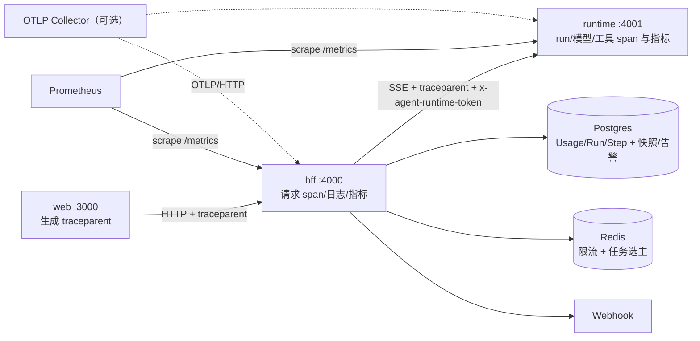

# M5b-2 可观测性设计（Observability）

- 日期：2026-10-20
- 状态：待评审
- 里程碑：M5b-2（M5b-1 管理端已交付，M5b-3 队列在后续排期）
- 关联：`docs/superpowers/specs/2026-10-19-m5b-admin-console-design.md`、`docs/deploy/06-deployment.md`、`docs/develop/05-dev-plan.md`

## 1. 目标与范围

为平台补齐全链路可观测能力，覆盖四块：

1. **结构化日志**：三进程统一 JSON 日志，字段一致、可脱敏、可按 traceId 检索。
2. **全链路 trace**：W3C `traceparent` 贯穿 web → BFF → runtime → 模型/工具调用，OTLP 导出可选。
3. **指标**：BFF 与 runtime 暴露 Prometheus 指标，覆盖请求、运行、模型、工具、计费与健康。
4. **看板与告警**：小时级指标快照、管理端运行概览与运行时间线、可配置阈值的内置告警规则、Webhook 通知与告警历史。

### 1.1 非目标

- BullMQ 任务队列、任务取消/重试、断点续跑（M5b-3）。
- 强制部署 OpenTelemetry Collector / Prometheus / Grafana / Alertmanager。
- span 明细落库（不新增 TraceSpan 表）。
- 自定义指标 DSL、任意 SQL/表达式告警、邮件/SMS 通知。
- 日志落库与站内日志检索（日志仍写 stdout，由外部日志系统采集）。
- 浏览器端 OTel SDK 与前端性能指标（Web Vitals）。

## 2. 验收标准

1. 浏览器发起一次 run，同一 `traceId` 出现在 web 请求头、BFF 请求日志、runtime 运行日志、模型/工具调用日志中；管理端运行详情的“时间线”显示该 traceId。
2. BFF `/metrics` 与 runtime `/metrics` 可被 Prometheus 抓取；未带内部凭据的非回环请求一律 401。
3. 管理端“运行概览”可按 24h/7d/30d 展示运行量、成功率、输入/输出 token、积分成本、运行时长与模型维度趋势。
4. 告警规则阈值可在管理端调整；触发后 Webhook 收到带签名的 `alert.fired`，恢复后收到 `alert.resolved`；告警历史包含投递状态与错误摘要。
5. 日志与指标中不出现 Authorization、内部 token、密码、API key、连接器 env、Webhook 签名密钥；指标不含 `userId/tenantId/sessionId/runId` 等高基数 label。
6. `pnpm test` 与 `pnpm build` 全绿；`.env.example`、部署文档、开发计划同步更新。

## 3. 架构



### 3.1 新增共享包 `packages/telemetry`

Node-only，供 BFF 与 runtime 复用，Web 不依赖：

- `initTelemetry({ serviceName, serviceVersion })`
  - 初始化 OTel `NodeSDK`：W3C `traceparent` 传播、AsyncLocalStorage 上下文、资源属性 `service.name/service.version/deployment.environment`。
  - 仅当设置 `OTEL_EXPORTER_OTLP_ENDPOINT` 时挂 OTLP/HTTP 导出器（`BatchSpanProcessor`）；未设置时使用 no-op 导出，不产生网络请求。
  - 初始化失败只记录错误并继续运行（可观测性 fail-open），不阻断业务。
- `withSpan(name, attributes, fn)`：手动埋点入口；异步与同步函数均支持。
- `currentTrace()`：返回 `{ traceId, spanId } | null`，供日志与 DB 记录使用。
- `runWithContext(ctx, fn)` / `currentContext()`：请求级上下文（requestId、userId、tenantId），基于 `AsyncLocalStorage`。
- `injectTraceparent(headers)` / `extractTraceparent(headers, fn)`：跨进程传播。
- `createLogger(service)`：pino JSON logger；`mixin` 自动注入 traceId/spanId/requestId/userId/tenantId。
- `shutdownTelemetry()`：flush 并关闭 SDK，供进程优雅退出调用。

包内不依赖 Nest；BFF 自行实现 `LoggerService` 适配器。

### 3.2 各进程职责

| 进程 | 职责 |
|---|---|
| web | 每次 BFF 请求生成 `traceparent` 与 `x-request-id`；不引入浏览器 OTel SDK |
| bff | 请求中间件：提取/生成 trace 上下文、开请求 span、结构化访问日志、HTTP 指标；run/计费 span；`/metrics`、`/api/health`；向 runtime 注入 traceparent；快照、告警评估与 Webhook |
| runtime | 提取 traceparent、run span；模型每次尝试 span 与失败/fallback 指标；工具 span；MCP 与 code.exec 计数；`/metrics` 与受保护的 `/metrics/summary` |

## 4. Trace

### 4.1 传播与采样

- 使用 W3C `traceparent`（版本 00），由 web 生成起始上下文；BFF、runtime 依次派生 child span。
- 采样率：默认 `1.0`，通过 `OTEL_TRACES_SAMPLER_ARG` 配置；生产建议 `0.1`。未采样请求仍保留 traceId 供日志关联，只是不导出 span。
- `Run.traceId` 在 run 创建时从当前上下文写入；无上下文（如测试/内部调用）写 `null`。
- span 属性只允许：模型名、工具名、状态、时长、token 数、`tenantId/userId`（仅 span 属性）、`runId`、`sessionId`。禁止写入 prompt、消息正文、工具入参与返回全文、密钥。

### 4.2 埋点边界

- BFF：HTTP 请求（含 SSE，span 在响应关闭时结束）、run 准备/预占、上游 runtime 调用、结算/补偿。
- runtime：`/runs` 整体、每轮模型调用（每次尝试单独 span）、每次工具执行（含 confirm 等待）、MCP 工具调用、`code.exec`。
- 长连接：SSE 请求 span 与运行时长一致；HTTP 指标按 route 统计，运营看板使用 run 指标而非 SSE 请求时长。

### 4.3 管理端时间线（不落 span）

`GET /api/admin/runs/:id/timeline` 由服务端聚合，避免依赖 span 存储：

- 输入：`Run.startedAt/endedAt/status/traceId`、该 run 全部 `Step`（`seq` 升序）、`UsageRecord`。
- 输出阶段：
  1. 受理（startedAt）
  2. 每轮模型思考（`think`，耗时取相邻 step 的 `ts` 差）
  3. 工具调用（`tool_call` 与下一条同名 `tool_result` 配对，含 `ok/denied/blocked` 与耗时）
  4. 产物（`artifact`）
  5. 确认等待（`confirm_request` 到对应 `tool_result`）
  6. 结束（endedAt/status）与 usage/积分汇总
- 时间线最多返回 500 个节点；超出时按阶段聚合并在响应中标记 `truncated`。
- 页面展示 traceId，并提供复制按钮，便于到日志/OTLP 后端检索。

## 5. 日志

### 5.1 格式与级别

- pino 输出单行 JSON 到 stdout；`start.ps1` 已重定向到 `logs/`，生产由容器日志驱动或 logrotate 负责轮转。
- 基础字段：`ts`（ISO）、`level`、`service`、`env`、`version`、`msg`；请求/业务日志自动附加 `traceId/spanId/requestId/userId/tenantId`。
- `LOG_LEVEL` 默认 `info`；本地 `LOG_PRETTY=1` 启用 pino-pretty（仅开发）。
- 错误日志统一 `err: { type, message, stack }`；生产保留 stack。

### 5.2 请求日志

- BFF 中间件在请求结束时输出一行：`method/route/status/durationMs/requestId/traceId`。
- `x-request-id` 只接受 `[A-Za-z0-9-]{1,64}`，否则由 BFF 重新生成（UUID），防止日志注入与超长字段。
- route 使用 Fastify 路由模板（如 `/api/admin/users/:id`），未匹配路由记为 `unmatched`。
- `/health`、`/metrics` 不记录访问日志；4xx 记 warn，5xx 记 error。
- 不记录请求体、响应体、查询串中的疑似密钥；需要业务上下文时只记录 ID。

### 5.3 脱敏

pino `redact` 覆盖：`authorization`、`cookie`、`set-cookie`、`x-internal-token`、`x-agent-runtime-token`、`password`、`token`、`apiKey`、`secret`、`webhookUrl`、连接器 env、S3/模型密钥。错误对象、HTTP 头、配置对象在进入日志前统一经过脱敏；审计日志不受影响（其字段由管理端显式构造）。

## 6. 指标

### 6.1 BFF 指标

| 指标 | 类型 | label |
|---|---|---|
| `ai_office_http_requests_total` | counter | `method,route,status` |
| `ai_office_http_request_duration_seconds` | histogram | `method,route` |
| `ai_office_runs_total` | counter | `status`（done/failed） |
| `ai_office_run_duration_seconds` | histogram | — |
| `ai_office_active_runs` | gauge | — |
| `ai_office_model_tokens_total` | counter | `model,type`（input/output） |
| `ai_office_model_credits_total` | counter | `model` |
| `ai_office_billing_settle_failures_total` | counter | — |
| `ai_office_rate_limit_hits_total` | counter | `scope`（tenant/global） |
| `ai_office_alerts_fired_total` | counter | `severity` |
| `ai_office_rollup_failures_total` | counter | — |
| `ai_office_service_up` | gauge | `service`（db/redis/runtime） |

### 6.2 runtime 指标

| 指标 | 类型 | label |
|---|---|---|
| `ai_office_model_requests_total` | counter | `model,status` |
| `ai_office_model_request_duration_seconds` | histogram | `model` |
| `ai_office_model_fallback_total` | counter | `from,to` |
| `ai_office_tool_calls_total` | counter | `tool,status` |
| `ai_office_tool_duration_seconds` | histogram | `tool` |
| `ai_office_mcp_restarts_total` | counter | `server` |
| `ai_office_mcp_tool_calls_total` | counter | `server,tool,status` |
| `ai_office_code_exec_timeout_total` | counter | — |
| `ai_office_active_runs` | gauge | — |

### 6.3 基数与实现约束

- 禁止以 `userId/tenantId/sessionId/runId` 作为 label；租户维度只进入 DB 快照。
- 每个应用持有独立 `prom-client.Registry`，并 `collectDefaultMetrics`（进程 CPU/内存/事件循环）；测试中不注册全局指标。
- 模型/工具 label 来自受控注册表；MCP 工具名按 `server.tool` 截断到 64 字符并去重。
- 直方图桶：HTTP 秒级 `[0.005, 0.01, 0.025, 0.05, 0.1, 0.25, 0.5, 1, 2.5, 5, 10, 30]`；模型 `[0.1, 0.25, 0.5, 1, 2.5, 5, 10, 20, 30, 60]`；工具 `[0.01, 0.05, 0.1, 0.25, 0.5, 1, 2.5, 5, 10, 30]`。

### 6.4 端点与保护

- BFF `GET /metrics`：满足“回环来源”或携带正确 `x-internal-token`（`INTERNAL_TOKEN`）才返回；否则 401。
- runtime `GET /metrics` 与 `GET /metrics/summary`：复用 `AGENT_RUNTIME_TOKEN` 校验；未配置 token 时仅回环。
- `/metrics/summary?windowMinutes=15` 返回 JSON：各模型在窗口内的请求数/错误数/平均延迟、fallback 次数、MCP 重启数、活跃 run 数；仅供 BFF 告警评估使用。
  - runtime 在内存中按分钟维护最近 60 分钟的模型请求/错误/延迟桶，summary 按请求窗口聚合；窗口越界夹取到 1–60 分钟，默认 15。
  - 进程重启后窗口从零开始，首轮数据不足时按已有样本计算；样本为空返回 `insufficient_data`，告警评估跳过该规则而非误报。
- `/api/health`：公开，仅返回 `{ status: 'ok', version }`。
- `/api/health/ready`：回环或内部 token；检查 DB `SELECT 1`、Redis ping（未配置则 `skipped`）、runtime `/health`（2s 超时），返回逐项状态；任一关键项失败返回 503。

## 7. 数据模型

```prisma
model Run {
  // 既有字段...
  traceId String?
  @@index([traceId])
  @@index([startedAt])
}

model Step {
  // 既有字段...
  @@index([ts])
}

model MetricBucket {
  id            String   @id @default(uuid())
  bucketStart   DateTime
  metric        String
  dimensionType String   @default("global") // global | model | tenant | tool
  dimensionId   String   @default("")
  value         Float
  count         Int      @default(0)
  updatedAt     DateTime @updatedAt

  @@unique([bucketStart, metric, dimensionType, dimensionId])
  @@index([metric, bucketStart])
  @@index([dimensionType, dimensionId, bucketStart])
}

model AlertRule {
  id              String   @id @default(uuid())
  key             String   @unique
  name            String
  metric          String
  comparator      String   // gt | lt
  threshold       Float
  windowMinutes   Int
  cooldownMinutes Int
  severity        String   // warning | critical
  enabled         Boolean  @default(true)
  createdAt       DateTime @default(now())
  updatedAt       DateTime @updatedAt
}

model AlertEvent {
  id             String    @id @default(uuid())
  ruleId         String
  ruleName       String
  status         String    // firing | resolved
  value          Float
  message        String
  startedAt      DateTime
  resolvedAt     DateTime?
  notifiedAt     DateTime?
  deliveryStatus String?   // sent | failed | skipped
  deliveryError  String?
  openKey        String?   @unique // firing 时写 ruleId，resolved 置 null，保证每规则仅一个 open 事件
  createdAt      DateTime  @default(now())

  @@index([ruleId, startedAt])
  @@index([status, startedAt])
  @@index([startedAt])
}
```

- `openKey` 利用 PostgreSQL 唯一索引允许多个 NULL 的特性，从数据库层保证“每规则最多一个 firing 事件”，避免多实例竞态。
- `UsageRecord` 增加 `@@index([createdAt])`，供小时级聚合与告警窗口查询。
- 所有时间存储为 UTC。

## 8. 指标快照（Rollup）

### 8.1 指标集合

| metric | dimensionType | 来源 | 含义 |
|---|---|---|---|
| `runs_started` | global/tenant | Run | 小时启动数（value=count） |
| `runs_done` / `runs_failed` | global/tenant | Run | 终态数量 |
| `run_duration_ms` | global/tenant | Run | value=总时长、count=样本数 |
| `input_tokens` / `output_tokens` | global/model/tenant | UsageRecord | token 总量 |
| `credits` | global/model/tenant | UsageRecord | 已结算积分 |
| `tool_calls` / `tool_failures` | tool | Step（tool_result.ok） | 工具调用量与失败量 |

- 语义固定：`value` 为该桶的聚合值（计数型为总量、`run_duration_ms` 为时长总和），`count` 为样本数（纯计数型指标为 0）；平均值 = `value / count`（仅时长类），token/积分/调用量直接展示 `value`。
- 告警不使用快照：短窗口直接查 DB + runtime summary，保证精度。

### 8.2 执行策略

- `MetricsSweeper` 每 5 分钟（`METRICS_ROLLUP_MS`）重算“当前小时之前 2 个完整小时”的快照并 upsert，容忍用量延迟结算；启动时补算最近 24 小时（可配置 `METRICS_BACKFILL_HOURS`）。
- 多实例通过 Redis `SET key value NX PX 55000` 选主；未获得锁直接跳过。Redis 未配置时本实例执行并每轮记 warn（单实例可用；多实例时 upsert 仍安全）。
- 每轮失败写日志并累加 `rollup_failures_total`，不影响下一轮重试。
- 保留 `METRICS_RETENTION_DAYS`（默认 90）天；每日分批（每批 5000 行）删除过期 `MetricBucket` 与 `AlertEvent`。
- 小时桶按 UTC 对齐；管理端查询接受 ISO 时间，返回 UTC ISO，Web 按浏览器时区展示。

## 9. 告警

### 9.1 内置规则

启动时按 `key` 幂等插入缺失规则（已存在则不改，保留管理员调整）：

| key | 指标 | 默认条件 | 窗口 | 冷却 | 级别 |
|---|---|---|---|---|---|
| `service_down` | `service_up` | `< 1` | 2m | 5m | critical |
| `run_failure_rate` | `run_failure_rate` | `> 0.2` | 15m | 15m | warning |
| `model_error_rate` | `model_error_rate` | `> 0.2` | 15m | 15m | warning |
| `run_latency_p95` | `run_latency_p95_ms` | `> 120000` | 15m | 15m | warning |
| `billing_settle_failure` | `billing_settle_failures` | `> 0` | 15m | 30m | critical |
| `credits_spike` | `credits_per_window` | `> 100000` | 60m | 60m | warning |

- `credits_spike` 默认 `enabled = false`，由管理员按业务规模设定阈值后启用。
- 指标口径：
  - `service_up`：BFF 对 db/redis/runtime 的探测结果，全部为 1 才视为健康。
  - `run_failure_rate`：窗口内 `Run.status='failed'` / 全部终态 run。
  - `model_error_rate`：runtime `/metrics/summary` 的模型请求错误率（各模型加权）。
  - `run_latency_p95_ms`：窗口内 `Run` 时长（endedAt-startedAt）的 P95，使用 PostgreSQL `percentile_cont`。
  - `billing_settle_failures`：窗口内创建超过 5 分钟仍为 `pending` 的 `UsageRecord` 数量（DB 查询，跨实例准确；对应 Prometheus 计数器 `ai_office_billing_settle_failures_total` 仅用于抓取侧告警/趋势）。
  - `credits_per_window`：窗口内已结算积分总量。

### 9.2 评估器

- `AlertSweeper` 默认每 60 秒（`ALERT_EVAL_MS`）执行；Redis 锁选主，未获锁跳过。
- 流程：读启用规则 → 计算窗口指标 → 与阈值比较 →
  - 首次越界：事务内创建 `AlertEvent(status=firing, openKey=ruleId)` 并发送 Webhook；唯一冲突说明已有 open 事件，不重复通知。
  - 持续越界：不重复通知，也不更新事件字段（保留首次触发时的 value/message）。
  - 恢复正常：将 open 事件置 `resolved`、`resolvedAt`、`openKey=null`，发送 `alert.resolved`。
  - 冷却：同一规则在 `cooldownMinutes` 内不重复创建新 firing 事件。
- 全局每小时通知上限 60 条（`ALERT_MAX_PER_HOUR`），超出只记事件不推送，并记 warn。
- 评估失败只记日志与指标，不中断下一轮。

### 9.3 Webhook

- 配置：全局 URL + 可选签名密钥；未配置 URL 时仍记录告警事件，`deliveryStatus='skipped'`。
- 请求：`POST`，`content-type: application/json`，5 秒超时，`redirect: 'manual'`（不跟随），仅允许 `http/https`。
- 签名：设置密钥时附 `x-ai-office-signature: sha256=<hex>`，对原始 JSON 体做 HMAC-SHA256。
- 重试：最多 3 次，退避 1s/5s/15s；最终结果写 `deliveryStatus/deliveryError`，失败累加日志与指标。
- 载荷：

```json
{
  "version": 1,
  "type": "alert.fired",
  "alert": {
    "id": "…",
    "ruleKey": "run_failure_rate",
    "ruleName": "运行失败率过高",
    "severity": "warning",
    "value": 0.31,
    "threshold": 0.2,
    "message": "最近 15 分钟失败率 31%，超过阈值 20%",
    "startedAt": "2026-10-20T06:00:00.000Z"
  },
  "dashboardUrl": "https://…/admin/alerts"
}
```

- 管理端“发送测试告警”使用同一投递器，载荷 `type: "alert.test"`，写审计。

## 10. 配置

### 10.1 环境变量

| 变量 | 默认 | 说明 |
|---|---|---|
| `LOG_LEVEL` | `info` | pino 日志级别 |
| `LOG_PRETTY` | 空 | 仅开发：`1` 启用可读格式 |
| `OTEL_EXPORTER_OTLP_ENDPOINT` | 空 | 设置后才导出 span；空则仅保留本地上下文 |
| `OTEL_EXPORTER_OTLP_HEADERS` | 空 | OTLP 请求头（如鉴权） |
| `OTEL_TRACES_SAMPLER_ARG` | `1.0` | 采样率，生产建议 `0.1` |
| `METRICS_ROLLUP_MS` | `300000` | 快照任务间隔；`0` 关闭 |
| `METRICS_BACKFILL_HOURS` | `24` | 启动补算小时数 |
| `METRICS_RETENTION_DAYS` | `90` | 快照保留天数 |
| `ALERT_EVAL_MS` | `60000` | 告警评估间隔；`0` 关闭 |
| `ALERT_RETENTION_DAYS` | `90` | 告警历史保留天数 |
| `ALERT_MAX_PER_HOUR` | `60` | 每小时 Webhook 上限 |
| `ALERTS_ENABLED` | `true` | 告警总开关（DB 可覆盖） |
| `ALERT_WEBHOOK_URL` | 空 | Webhook 地址（DB 可覆盖） |
| `ALERT_WEBHOOK_SECRET` | 空 | 签名密钥（DB 可覆盖，读取时脱敏） |

### 10.2 Settings 类型化

- `SettingsService` 从“仅 number”扩展为 `number | string | boolean | secret`：
  - 每个 key 声明类型、范围/长度校验、env 兜底、来源（db/env/default）。
  - secret 类在 `GET /api/admin/settings` 中只返回 `{ configured: true }` 与脱敏值，不回传明文；更新时传新值或显式清空。
- 新增 key：`alertsEnabled`（boolean）、`alertWebhookUrl`（string）、`alertWebhookSecret`（secret）。
- 既有 number 型 key 的行为、来源解析与校验保持不变；管理端参数页按类型渲染输入控件。

## 11. 管理端与 API

### 11.1 页面

- `/admin/overview`：运行概览
  - KPI 卡：运行数、成功率、输入/输出 token、积分成本、平均与 P95 时长、未恢复告警数。
  - 趋势：运行量与失败量、token、积分（按模型堆叠）、时长；范围 24h/7d/30d；60 秒自动刷新，页面不可见时暂停。
  - 服务健康：db/redis/runtime 状态与最近采集时间。
  - 图表使用内联 SVG（不新增图表库），按 dataviz 规范配色、标注与可访问性。
- `/admin/alerts`：告警中心
  - 规则表：名称、指标、阈值、窗口、冷却、级别、启停；仅允许改阈值/窗口/冷却/级别/启停。
  - 事件表：状态、规则、值、开始/恢复时间、投递状态与错误摘要；按状态与时间筛选。
  - “发送测试告警”按钮；显示最近一次投递结果。
- `/admin/tasks` 运行详情：新增“时间线”区块（traceId、阶段、工具耗时、usage/积分、失败点高亮）。
- `/admin` 默认重定向改为 `/admin/overview`；导航新增“运行概览”“告警中心”。

### 11.2 接口

全部位于 `/api/admin/*`，统一 `JwtGuard + AdminGuard`，DTO 定义在 `packages/shared`：

- `GET /api/admin/overview?range=24h|7d|30d`
  - 返回：当前/上一周期 KPI、环比、时间序列、模型成本分布、未恢复告警、服务健康。
- `GET /api/admin/metrics/timeseries?metrics=…&from=…&to=…&granularity=hour|day&dimensionType=global|model|tenant|tool&dimensionId=…`
  - 返回按桶对齐的序列；缺桶补 0；限制最多 4 个 metric、时间跨度 ≤ 90 天。
- `GET /api/admin/alert-rules`
- `PATCH /api/admin/alert-rules/:id` body `{ threshold?, windowMinutes?, cooldownMinutes?, severity?, enabled? }`
  - 范围校验：window 1–1440、cooldown 0–1440、threshold 有限数；写 `alertRule.update` 审计。
- `GET /api/admin/alert-events?status=&from=&to=&page=&pageSize=`
- `POST /api/admin/alert-rules/:id/test`
  - 发送 `alert.test` 载荷；写 `alertRule.test` 审计；记录投递结果。
- `GET /api/admin/runs/:id/timeline`
  - 返回运行时间线；敏感查看写 `run.timeline_view` 审计（best-effort）。

### 11.3 权限与审计

- 管理员跨租户只读指标与告警；规则修改与测试发送写审计（与业务写同事务或紧随其后 best-effort，规则写采用事务）。
- 指标接口不返回用户邮箱、消息内容、工具入参/结果正文。
- 管理端页面沿用现有错误文案与角色守卫；403 跳回 `/`。

## 12. 安全与可靠性

- **fail-open**：遥测、日志、指标、快照、告警任一子系统异常都不得阻断用户请求；初始化失败降级并告警。
- **端点保护**：`/metrics`、`/metrics/summary`、`/api/health/ready` 仅回环或内部 token；部署文档要求反代显式拒绝外网路径。
- **脱敏**：日志白名单字段 + pino redact；禁止请求体；secret 设置不回传明文。
- **高基数**：指标 label 受控；`route` 模板化；模型/工具名截断去重；租户维度仅快照。
- **多实例**：快照与告警任务用 Redis 锁选主；锁 TTL 55s，任务超过 TTL 时下一轮可能重入，upsert 与 `openKey` 唯一约束保证幂等。Redis 未配置时各实例都会执行：快照 upsert 安全；告警由 `openKey` 唯一冲突兜底，只有抢到插入的实例发送通知。
- **Webhook**：仅 http/https、固定超时、禁止重定向、重试上限、签名密钥不落日志；URL 仅管理员可改。
- **数据一致性**：快照按小时 upsert；重算最近 2 小时容忍延迟结算；`openKey` 唯一约束防止重复 firing；告警恢复与通知失败不回滚事件。
- **资源边界**：时间线 500 节点上限；快照清理分批；Prometheus 指标不保存明细；日志不记录大 payload。
- **时钟**：统一 UTC；评估窗口以服务器时间为准，多实例允许秒级偏差。

## 13. 测试策略

- **单元**
  - traceparent 解析/注入/非法输入；日志字段与脱敏；route 模板化。
  - 指标计数与 histogram；独立 Registry 不重复注册。
  - 快照聚合（run/usage/tool）、upsert 幂等、迟到数据重算、保留期删除分批。
  - 告警比较、冷却、恢复、`openKey` 唯一冲突、全局限流。
  - Webhook 签名、超时、重试、失败记录；Settings 类型校验与 secret 脱敏。
  - 时间线配对（tool_call/tool_result、confirm、truncated）。
- **集成**
  - BFF 请求 → mock runtime：断言 traceparent 透传、请求日志字段、HTTP 指标。
  - `/metrics` 鉴权（回环、token、错误 token）；`/api/health/ready` 各项状态。
  - 管理端 overview/timeseries/alerts/timeline 的鉴权、参数校验与分页。
  - 用假定时器驱动快照与告警 sweeper。
- **端到端（本地全栈）**
  - mock 模型跑一次任务 → 同一 traceId 贯穿、`/metrics` 计数增加、快照落库、管理端概览可见。
  - 本地 Webhook 接收器：阈值触发 → fired → 恢复 → resolved；签名可验证；历史与投递状态正确。
- **测试环境**：默认不设置 OTLP、不启动真实 sweeper 定时器；用注入的时钟/锁/HTTP 客户端。

## 14. 交付切片

预计 13 个 Task，按依赖顺序：

1. `packages/telemetry`：OTel/pino/prom-client 封装、trace 上下文、日志脱敏、shutdown。
2. BFF 接入：请求中间件（trace/日志/HTTP 指标）、Nest Logger 适配、`/metrics`、`/api/health`、上游 traceparent 注入。
3. runtime 接入：`/runs` 上下文、模型尝试/fallback、工具、MCP、code.exec 指标与 span、`/metrics`、`/metrics/summary`。
4. web：`traceparent` 与 `x-request-id` 注入。
5. 数据模型与 shared DTO：`Run.traceId`、索引、`MetricBucket`、`AlertRule`、`AlertEvent`、时间线/概览 DTO。
6. Settings 类型化（number/string/boolean/secret）与 secret 脱敏。
7. 快照任务：聚合、upsert、补算、保留期清理、Redis 选主。
8. 告警：内置规则初始化、评估器、Webhook 投递器、签名与重试。
9. 管理 API：overview、timeseries、alert-rules、alert-events、test、timeline。
10. 运行概览页与导航/落地页调整。
11. 告警中心页与参数页类型化输入。
12. 运行时间线 UI。
13. `.env.example`、部署文档（抓取/反代/OTLP/保留期）、开发计划状态与端到端验证。

每个 Task 完成即提交（中文 commit message），并运行相关单测；里程碑收尾执行全量 `pnpm test` 与 `pnpm build`。

## 15. 风险与缓解

| 风险 | 影响 | 缓解 |
|---|---|---|
| OTel/pino 依赖增加构建体积与启动开销 | 部署变慢 | 仅手动埋点，不引入自动 instrumentation；未配置 OTLP 时不导出 |
| SSE 长连接导致请求指标失真 | 看板误判 | 运营指标使用 run 数据；SSE span 在 close 时结束 |
| 多实例重复告警/重复快照 | 通知风暴、写放大 | Redis 选主 + `openKey` 唯一约束 + upsert 幂等 |
| 快照扫描 `Step` 表成本 | 库压力 | 增加 `Step.ts`/`Run.startedAt`/`UsageRecord.createdAt` 索引；只重算最近 2 小时 |
| Webhook 接收方不可用 | 告警丢失 | 重试 + 投递状态/错误落库 + 管理端可见 + 失败指标 |
| 日志含敏感信息 | 合规风险 | 白名单字段 + 统一脱敏 + 不记录请求体；测试覆盖 |
| Settings DTO 类型放宽影响既有页面 | 回归 | 保持既有 number key 行为不变，补参数页渲染测试 |
| 指标基数失控 | Prometheus 压力 | 禁用高基数 label、route 模板化、工具名截断、限制自定义维度 |
